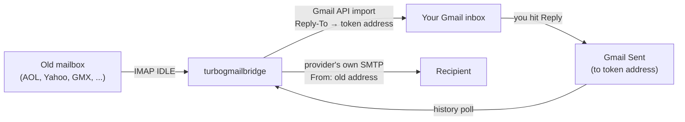

<a id="readme-top"></a>
<div align="center">
  <h1>Turbogmailbridge</h1>
  <p>Read and answer your old IMAP/SMTP mailboxes from Gmail: a self-hosted importer with a two-way reply bridge. 📬</p>
  <p>
    <a href="https://github.com/pauldev20/turbogmailify/actions/workflows/go-test.yml"></a>
    <a href="https://github.com/pauldev20/turbogmailify/actions/workflows/docker-publish.yml"></a>
    <a href="https://github.com/pauldev20/turbogmailify/pkgs/container/turbogmailify"></a>
    <a href="https://go.dev"></a>
    <a href="./LICENSE"></a>
  </p>
  <p>
    <a href="#-about">About</a>
    ·
    <a href="#-features">Features</a>
    ·
    <a href="#-getting-started">Getting Started</a>
    ·
    <a href="#-configuration">Configuration</a>
    ·
    <a href="#-how-the-bridge-works">How It Works</a>
    ·
    <a href="#-docker">Docker</a>
  </p>
</div>
<br />



## 📖 About

Gmail drops POP fetch in January 2026, and Gmailify plus "Send mail as" for third-party addresses in January 2027. After that, Gmail can neither collect mail from your old accounts nor send as them. Plain forwarding is no fix: Gmail silently drops forwarded mail that looks like spam, and providers like AOL and Yahoo publish `DMARC p=reject`, so mail claiming to be from them must leave through their own SMTP servers.

Turbogmailbridge is a fork of [turbogmailify](https://github.com/YoRyan/turbogmailify) by Ryan Young. It keeps every turbogmailify feature (fast IMAP → Gmail import through the official Gmail API) and adds an optional **two-way bridge**: replies you write in any Gmail client are relayed through the old account's SMTP server, so recipients see your old address and never see Gmail.

It is built for people who self-host and want to retire an old mailbox into Gmail without losing the address. It is not meant for custom domains you control (use proper DNS and a relay there), and it does not sync read state, folders, or deletions back to the source account.

> [!NOTE]
> Not affiliated with or endorsed by Google. "Gmail" is a trademark of Google LLC.

## ✨ Features

- **Near-instant import** — uses IMAP IDLE on every configured folder (one extra read-only connection per folder besides `IdleFolder`), renews it every 4 minutes to stay under short server timeouts such as AOL's, reconnects every 50 minutes before AOL's one-hour session limit, and checks every folder at least that often.
- **Safe by design** — a message is expunged from the IMAP server only after Gmail confirms the import; optional archive folders keep the source copy instead.
- **Spam verdicts kept** — mail from the provider's Junk folder gets Gmail's `SPAM` label, and the bridge imports each original unmodified first so Gmail's own classifiers see the real sender.
- **Multiple accounts, custom labels** — any number of IMAP accounts in one process, with per-folder Gmail label mapping.
- **Reply from Gmail as your old address** — the bridge rewrites reply addresses to stable token addresses, then relays your replies through each account's own SMTP server.
- **Leak-checked outbound mail** — headers rebuilt from an allowlist, token addresses and `(via …)` names scrubbed, and a final leak check blocks anything that still mentions Gmail.
- **Guard rails** — `DryRun` by default, a `MaxSendsPerHour` limit, idempotency records per message, and `Bridge/*` labels plus notifications for anything that could not be relayed.
- **Small footprint** — one static binary, TOML or JSON config, no web UI, no database server, only outbound connections.

## 🚀 Getting Started

### Prerequisites

| Requirement | Version | Notes |
|---|---|---|
| [Go](https://go.dev/dl/) | ≥ 1.27 | Only to build from source |
| [Docker](https://docs.docker.com/get-docker/) | any recent | Only to run the container image |
| Google account | — | The Gmail inbox mail is delivered to |
| Google Cloud project | — | Free; holds your OAuth client (step 1) |
| App passwords | — | For each IMAP/SMTP account; see [docs/providers.md](./docs/providers.md) |

### 1. Create a Google OAuth client

1. [Create](https://console.cloud.google.com/projectcreate) a project in Google Cloud Console.
2. [Enable](https://console.cloud.google.com/apis/api/gmail.googleapis.com) the Gmail API for it.
3. [Configure](https://console.cloud.google.com/auth/branding) the OAuth branding. Personal accounts can only create "External" projects; that is fine.
4. [Add](https://console.cloud.google.com/auth/audience) the Gmail account you deliver to as a test user.
5. [Publish](https://console.cloud.google.com/auth/audience) the project to "In Production" so tokens live longer than one week. You do not need verification.
6. [Create](https://console.cloud.google.com/auth/clients) a client of type **Desktop**.
7. Download the client's JSON secrets file.

### 2. Build or pull

```bash
# From source
git clone https://github.com/pauldev20/turbogmailify.git
cd turbogmailify
go build            # produces ./turbogmailbridge

# Or use the container image
docker pull ghcr.io/pauldev20/turbogmailify:latest
```

### 3. Write the config

```bash
cp turbogmailbridge.example.toml turbogmailbridge.toml   # *.toml is git-ignored
```

Paste the downloaded secrets JSON into `Secrets`, then fill in your accounts. Leave `DryRun = true` and keep `[Imap.ArchiveFolders]` set for the first run, so nothing is deleted or sent while you check labels and logs. See [Configuration](#-configuration) for every key.

### 4. Authorize with Google

```bash
# Flags must come before the config file path
./turbogmailbridge -auth -toml turbogmailbridge.toml
```

Open the printed URL, approve access, and paste the `http://localhost…` URL your browser fails to load back into the terminal. Copy the printed JSON into the `Tokens` key.

> [!IMPORTANT]
> The requested scope depends on your config: import-only uses `gmail.insert`, the bridge needs `gmail.modify`, and `DeleteOriginal = true` needs full mail access. Run `-auth` again whenever you add the `[Bridge]` section or change `DeleteOriginal`.

### 5. Run

```bash
./turbogmailbridge -toml turbogmailbridge.toml
```

It runs until stopped. For a permanent setup, use [Docker](#-docker) or the systemd unit below.

<details>
<summary><b>systemd unit</b></summary>

```ini
[Unit]
Description=Turbogmailbridge IMAP/SMTP to Gmail

[Service]
Type=exec
ExecStart=/usr/local/bin/turbogmailbridge -toml /etc/turbogmailbridge.toml
Restart=always
RestartSec=10s

[Install]
WantedBy=multi-user.target
```

</details>

## 🔧 Configuration

One config file, TOML or JSON. JSON is the default for compatibility with early turbogmailify versions; pass `-toml` for TOML (recommended). [`turbogmailbridge.example.toml`](./turbogmailbridge.example.toml) is a complete, commented starting point.

### Command-line flags

| Flag | Description |
|---|---|
| `-toml` | Parse the config as TOML, with `Secrets` and `Tokens` as strings |
| `-auth` | Run the Google OAuth flow and print the `Tokens` JSON instead of processing mail |
| `-healthcheck` | Exit non-zero if the outbound poller has not reached Gmail in `max(5m, 10 × PollInterval)`; requires `[Bridge]` |

### Top-level keys

| Key | Description |
|---|---|
| `Secrets` | Contents of the Google client secrets JSON (a string in TOML, an object in JSON) |
| `Tokens` | Output of `-auth` (a string in TOML, an object in JSON) |
| `[[Imap]]` | Array of IMAP accounts to import from |
| `[Bridge]` | Optional. Enables the two-way bridge |

### `[[Imap]]` — per account

| Key | Default | Description |
|---|---|---|
| `Address` | — | `host:port`; the server must support implicit TLS (usually `993`) |
| `Username`, `Password` | — | IMAP credentials, usually an app password |
| `Folders` | `INBOX → ["INBOX"]`, `Junk → ["SPAM"]` | IMAP folder → array of Gmail label IDs |
| `FailedFolders` | in-memory | IMAP folder → folder for messages Gmail rejects (e.g. `.exe` attachments). `*` is a wildcard. Recommended, otherwise rejects are retried after a restart |
| `ArchiveFolders` | expunge | IMAP folder → folder to move imported mail to instead of expunging. `*` is a wildcard. Folders must exist |
| `IdleFolder` | `INBOX` | Folder IDLEd on by the main connection. Other folders are watched on their own read-only connections |
| `NeverMarkSpam` | `Junk = true`, `* = false` | IMAP folder → Gmail "Never mark spam" flag |
| `ProcessForCalendar` | `Junk = false`, `* = true` | IMAP folder → Gmail "Process for calendar" flag |
| `[Imap.Bridge]` | — | Optional. Bridges this account (needs top-level `[Bridge]`) |

> [!TIP]
> Gmail user labels are referenced by ID (e.g. `Label_123`), not by name. Run [List Gmail Labels.js](./List%20Gmail%20Labels.js) as a [Google Apps Script](https://script.google.com/home) to list them. System labels like `INBOX` and `SPAM` use their names.

### `[Bridge]` — global bridge settings

| Key | Default | Description |
|---|---|---|
| `GmailAddress` | — | Your Gmail address, without a `+suffix` |
| `StateDir` | — | Holds `token.key` and `state.db`. Must be persistent and backed up |
| `RewriteMode` | `reply-to` | `reply-to` rewrites reply headers only; `full` also rewrites `From` |
| `PollInterval` | `3s` | How often Gmail's `SENT` history is polled (minimum `1s`) |
| `MaxSendsPerHour` | `50` | SMTP send attempts per hour across all accounts |
| `DryRun` | `true` | Label outbound mail `Bridge/DryRun` and never send |
| `DeleteOriginal` | `false` | Permanently delete originals and stand-ins instead of trashing them (needs full mail scope) |
| `LabelPrefix` | `Bridge` | Prefix for the bridge's Gmail labels |
| `BackfillInterval` | `1.5s` | Minimum time between messages rewritten by `BackfillQuery` |

### `[Imap.Bridge]` — per bridged account

| Key | Default | Description |
|---|---|---|
| `Alias` | — | `[a-z0-9]{1,8}`; appears in token addresses (`you+a1.…@gmail.com`) |
| `DisplayTag` | — | Shown in names as `Max (via AOL1)` |
| `SendAs` | — | `From` for relayed mail, e.g. `"Your Name <old@aol.com>"` |
| `GmailLabel` | — | Optional label ID added to this account's mail (Gmail filters do not run on inserted mail) |
| `MessageIDDomain` | `SendAs` domain | Domain used in generated `Message-ID`s |
| `BackfillQuery` | — | Optional Gmail search, e.g. `label:old@aol.com after:2018/01/01`. Matching mail already in Gmail is rewritten once at startup; see [Backfilling existing mail](#backfilling-existing-mail) |
| `[Imap.Bridge.Smtp]` `Address` | — | SMTP submission server, `host:port` |
| `[Imap.Bridge.Smtp]` `Security` | — | `tls` (port 465) or `starttls` (port 587) |
| `[Imap.Bridge.Smtp]` `Username`, `Password` | IMAP credentials | SMTP credentials |

Accounts without `[Imap.Bridge]` keep plain turbogmailify behavior. Starting settings for AOL, Yahoo, GMX, Web.de, iCloud and Fastmail are in [docs/providers.md](./docs/providers.md).

<details>
<summary><b>Minimal import-only config (TOML and JSON)</b></summary>

```toml
Secrets = '''
{"installed":{"client_id":"xxx.apps.googleusercontent.com","client_secret":"GOCSPX-xxx","project_id":"my-project","auth_uri":"https://accounts.google.com/o/oauth2/auth","token_uri":"https://oauth2.googleapis.com/token","redirect_uris":["http://localhost"]}}
'''
Tokens = '''
{"access_token":"xxx","token_type":"Bearer","refresh_token":"xxx","expiry":"2026-01-01T00:00:00Z"}
'''

[[Imap]]
Address = "imap.example.com:993"
Username = "me@example.com"
Password = "app-password"
  [Imap.Folders]          # inline tables go after the plain keys
  INBOX = ["INBOX"]
  Junk = ["SPAM"]
  [Imap.FailedFolders]
  "*" = "Failed"
```

```json
{
  "Secrets": { "installed": { "client_id": "xxx.apps.googleusercontent.com", "client_secret": "GOCSPX-xxx", "...": "..." } },
  "Tokens": { "access_token": "xxx", "token_type": "Bearer", "refresh_token": "xxx", "expiry": "2026-01-01T00:00:00Z" },
  "Imap": [
    {
      "Address": "imap.example.com:993",
      "Username": "me@example.com",
      "Password": "app-password",
      "Folders": { "INBOX": ["INBOX"], "Junk": ["SPAM"] },
      "FailedFolders": { "*": "Failed" }
    }
  ]
}
```

</details>

<div align="right"><a href="#readme-top">↑ back to top</a></div>

## 🧩 How the Bridge Works

**Inbound.** Each message is imported unmodified, so Gmail's spam and category classifiers see the real sender. The bridge then inserts a copy with the same labels and thread in which `Reply-To`, `To`, `Cc`, `Mail-Followup-To`, `Mail-Reply-To`, `List-Unsubscribe` and `List-Post` (and with `RewriteMode = "full"` also `From`) point at token addresses such as `"Max (via AOL1)" <you+a1.k7f3qx2m9p@gmail.com>`, and trashes the original. Original headers are kept as `X-Bridge-Original-*`. Only then is the source copy expunged.

**Outbound.** Replying in any Gmail client (web, apps, IMAP, Gmail SMTP, API) sends to the token address. The bridge polls Gmail's `SENT` history, maps tokens back to real addresses, rebuilds the message from a header allowlist, scrubs token addresses and `(via …)` names, runs a leak check, and submits it through the account's own SMTP server. The relayed copy is filed in Sent and the stand-in is trashed.

**Tokens** are `base32(HMAC-SHA256(key, alias, address))[:10]`: stable per account and correspondent, and unguessable without `StateDir/token.key`. Only messages carrying Gmail's `SENT` label are ever relayed, so strangers mailing a token address cannot trigger a send.

Messages that cannot be relayed safely get one of these labels and a notification:

| Label | Meaning |
|---|---|
| `Bridge/DryRun` | `DryRun = true`; the message would have been sent |
| `Bridge/Blocked` | The leak check or a safety rule stopped it |
| `Bridge/Mixed` | A recipient was typed as a real address; Gmail delivered it directly |
| `Bridge/Failed` | SMTP submission failed or its outcome is unknown |

### Backfilling existing mail

Mail that reached Gmail without the bridge, e.g. before it was set up, still carries real addresses, so replying to it sends from Gmail. Set `BackfillQuery` on an account to rewrite it in place:

```toml
  [Imap.Bridge]
  Alias = "a1"
  # ...
  BackfillQuery = "label:old@aol.com after:2018/01/01"
```

At startup, in the running bridge, every match is processed newest first, one account after another: the raw mail is rewritten like inbound mail, inserted with all of the original's labels (including `SENT` and `UNREAD`) in the same thread, recorded so the relay ignores it, and only then is the original trashed (or deleted with `DeleteOriginal`). The copy carries `X-Bridge-Backfill-Of: <alias>/<original Gmail id>`, plus a generated `Message-ID` (`backfill.<alias>.<id>@bridge.invalid`) if the original had none, so an interrupted run recognises it.

- **Your own sent mail** (`From` is the account's address) gets only `To` and `Cc` rewritten. `From` and `Reply-To` stay, so replying to your own message goes to its recipients through the bridge instead of back to you. Gmail only treats the message as yours if the account's address is a [Send mail as](https://support.google.com/mail/answer/22370) address in Gmail; otherwise replies go to that address directly.
- **Skipped:** messages the bridge already wrote (`X-Bridge-Original-From`), messages it already handled (imported, relayed, or backfilled), drafts, and mail addressed to token addresses.
- **Malformed** messages that cannot be rewritten (including mail without `From`) are left untouched and listed in the summary.
- **Stop and resume any time.** A restart skips what is done. An original whose copy may already exist, after a crash or an insert that failed with a server error, is matched to that copy on the next start instead of being copied again, even if it no longer matches the query. Failed messages are listed in the summary and retried on the next start; once a run completes without failures it is not repeated. Change the query to run again. Prefer absolute dates (`after:2018/01/01`) over relative ones (`newer_than:7d`), which shift between restarts.
- **Stops instead of duplicating.** If an original cannot be trashed or deleted (for example `DeleteOriginal = true` without the full mail scope), the run stops after that message and notifies you, rather than leaving every mail twice. Fix the cause and restart.
- **`DryRun = true`** only logs what would change per message (old and new address headers, labels) and modifies nothing, including the state db.
- **Rate.** One message per `BackfillInterval` (default `1.5s`, 40 a minute). Gmail allows 6,000 quota units per user and minute and each message costs 105, so the default leaves room for the relay and imports; projects on Gmail's older, higher quotas can lower it. Rate limits (`429`, rate-limit `403`), `5xx` and network errors are retried with backoff. An insert is never simply repeated: after any error the bridge waits for Gmail's search index and looks for a copy Gmail may have stored anyway; after a `5xx` or network error it never inserts that message again in the same run. Progress with counts and an ETA is logged every 30 seconds, and a summary is logged and sent as a notification at the end.

> [!TIP]
> Start with `DryRun = true` and a narrow query such as `label:old@aol.com newer_than:7d`, check the log, then widen it.

> [!WARNING]
> Back up `StateDir/token.key`. If it is lost, every reply address in existing mail stops resolving.

### Limitations

- A recipient typed as a real address is delivered by Gmail directly and cannot be intercepted; the bridge only labels it `Bridge/Mixed` afterwards.
- Gmail Calendar RSVPs and the vacation responder may answer from your Gmail address.
- Gmail filters do not run on inserted messages. Use `GmailLabel` per account instead. On plain imports, filters work only partly ("Has the words" and "To" reportedly work, "From" does not; [source](https://github.com/YoRyan/turbogmailify/pull/47)).
- The compose window shows `(via AOL1)` names. Gmail autocomplete learns them, so new mail to such a contact also goes out through that account.
- Inbound mail takes about a second longer (import, insert, trash).
- Quoted HTML keeps Gmail's markup (e.g. `class="gmail_quote"`), which hints that Gmail was used.
- If filing the relayed copy in Sent fails, you are notified but it is not retried; the stand-in stays in Sent.
- If the connection drops while the SMTP server confirms a message, the bridge cannot tell whether it was sent. It does not retry; it labels the stand-in `Bridge/Failed` and notifies you.
- Outlook.com and Hotmail require OAuth for IMAP/SMTP, which is not supported.

<div align="right"><a href="#readme-top">↑ back to top</a></div>

## 🐳 Docker

The image is built from [`Containerfile`](./Containerfile) for `linux/amd64` and `linux/arm64` and published to GHCR on every push to `main`. It runs as UID `10001` from a `scratch` base, makes only outbound connections, and keeps bridge state in `/data`.

Authorize once, interactively:

```bash
docker run -it --rm \
  -v ./turbogmailbridge.toml:/config/turbogmailbridge.toml:ro \
  ghcr.io/pauldev20/turbogmailify:latest \
  -auth -toml /config/turbogmailbridge.toml
```

Then run it with Compose. This mirrors [compose.example.yaml](./compose.example.yaml):

```yaml
services:
  turbogmailbridge:
    image: ghcr.io/pauldev20/turbogmailify:latest
    restart: unless-stopped
    command: ["-toml", "/config/turbogmailbridge.toml"]
    volumes:
      - ./turbogmailbridge.toml:/config/turbogmailbridge.toml:ro
      - bridge-data:/data          # token.key + state.db; back this up
    healthcheck:
      test: ["CMD", "/main", "-healthcheck", "-toml", "/config/turbogmailbridge.toml"]
      interval: 60s

volumes:
  bridge-data:
```

Set `StateDir = "/data"` in `[Bridge]` so state lands on the volume. Without a `[Bridge]` section, drop the `healthcheck` and the volume.

## ❓ FAQ

<details>
<summary><b>Why not forward mail to Gmail?</b></summary>

Gmail silently drops forwarded messages that look like spam, including false positives, and those count against the forwarding domain's reputation. Importing through the Gmail API avoids the delivery path entirely.

</details>

<details>
<summary><b>Why not a paid service such as Gomailify or Postdirect?</b></summary>

Paying is easier. Self-hosting keeps your private mail and provider passwords off third-party servers. A VPS is optional: your IMAP provider already handles availability for receiving, so a home server that is up most of the time is enough.

</details>

<details>
<summary><b>Why not IMAP-to-IMAP sync (imapsync, Magpie)?</b></summary>

This tool is built for Gmail: it uses Gmail's OAuth flow, labels, import flags and history API. Treating Gmail as a plain IMAP server always causes friction, and IMAP sync cannot send replies as your old address.

</details>

<details>
<summary><b>Do I need the bridge?</b></summary>

No. Without a `[Bridge]` section the program behaves exactly like upstream turbogmailify and only imports mail.

</details>

## 🔒 Security

The config file holds your Google OAuth tokens and provider passwords: never commit it (`*.toml` and `*.conf` are git-ignored) and mount it read-only. Anyone with the tokens can read and modify your mailbox. See [SECURITY.md](./SECURITY.md) for the threat model and how to report vulnerabilities privately.

## 🤝 Contributing

Issues and pull requests are welcome. Run the tests before opening a PR:

```bash
go test ./...
```

The bridge lives in [`internal/bridge`](./internal/bridge).

## 📚 Acknowledgements

- [turbogmailify](https://github.com/YoRyan/turbogmailify) by Ryan Young, the IMAP → Gmail importer this fork builds on ([background post](https://youngryan.com/2024/check-emails-from-gmail-briskly-go-getmail/)).
- [emersion/go-imap](https://github.com/emersion/go-imap) and [go-message](https://github.com/emersion/go-message) for IMAP and MIME handling.
- [bbolt](https://github.com/etcd-io/bbolt) for the bridge's state store.

## 📄 License

[MIT](./LICENSE) © 2024–2026 Ryan Young, © 2026 Paul Geeser.

---

<div align="center">
  <sub>If you like this project, you can buy me a coffee ☕ — it would be greatly appreciated!</sub>
  <br /><br />
  <a href="https://www.buymeacoffee.com/pauldev"></a>
</div>
